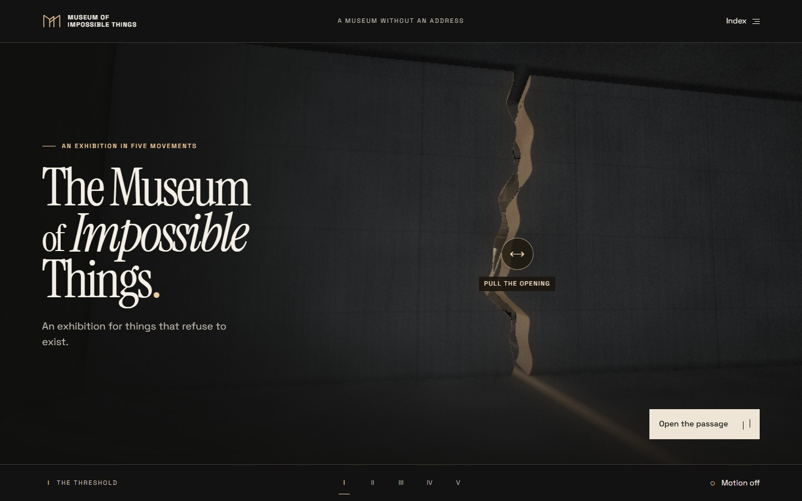

# The Museum of Impossible Things

**An exhibition for things that refuse to exist.**



[Visit the live museum](https://amanor-12.github.io/museum-of-impossible-things/) · [Portfolio gallery](docs/portfolio/README.md) · [Creative research](docs/creative-research.md)

Pull open a fault in a graphite wall. Cross it, relight an object, leave a sentence in the building, and turn gravity over. On the way out, download a print of your visit. One shared opening controls the parted walls, the alignment of the corridor, the angle of the suspended foil, and the displacement of the inscription.

## Engineering

The primary experience uses React, TypeScript, Vite, and a small, purpose-built WebGL renderer. The scene is a signed distance field authored in GLSL. A single full-screen triangle drives camera rays through the room, refining hit positions as they approach surfaces. Procedural aggregate, grazing light, a narrow floor reflection, and fog distinguish cast concrete from the suspended foil without external texture downloads.

The scene renderer draws in response to input, camera interpolation, viewport changes, and visibility changes. Moving frames use a smaller pixel budget, a shorter ray march, and cheaper surface shading. The renderer lowers the interactive budget further when frames arrive slowly and redraws a detailed still when motion settles. Input uses pointer capture on the fault itself, with arrow-key increments, Home and End, and a separate button for opening and crossing. Reduced motion removes camera tweening. The fallback uses genuine scene captures with movable CSS wall panels. The WebGL renderer projects the inscription onto the two moving wall surfaces. It uploads a small text atlas when the phrase changes. A readable transcript and clipped HTML fallback are available alongside the artwork.

The original three-exhibit version remains available as an [exhibition archive](https://amanor-12.github.io/museum-of-impossible-things/?archive). The archive loads Three.js, React Three Fiber, Drei, and GSAP only on that route. Its rooms retain material states, kinetic typography, and the folding corridor.

## Development

Requires Node.js 24 and npm.

```sh
npm ci
npm run dev
```

```sh
npm run typecheck
npm run lint
npm test
npm run build
npx playwright install chromium
npm run test:e2e
```

The Playwright suite runs against the production preview. Set `MUSEUM_TEST_URL` to test a deployment. Use `?flat` for the non-WebGL experience. The site is static and uses relative asset paths for GitHub Pages.

- `src/threshold/` contains the primary experience, renderer, shader, and scene styling.
- `src/MuseumArchive.tsx` and `src/experience/` contain the original three-exhibit experience.
- `tests/` covers gesture and keyboard controls, browser history, material states, custom inscriptions, lighting and inversion, PNG export, navigation, mobile layout, and WebGL fallbacks.

The exhibition is silent. Browser verification targets Chromium desktop and mobile layouts. Physical-device GPU performance remains unmeasured.

## Credits

The museum identity, artwork, geometry, shaders, and previews were created for this project. Instrument Serif, Space Grotesk, and Bodoni Moda are distributed under the SIL Open Font License. [Font notices](docs/font-licenses)
