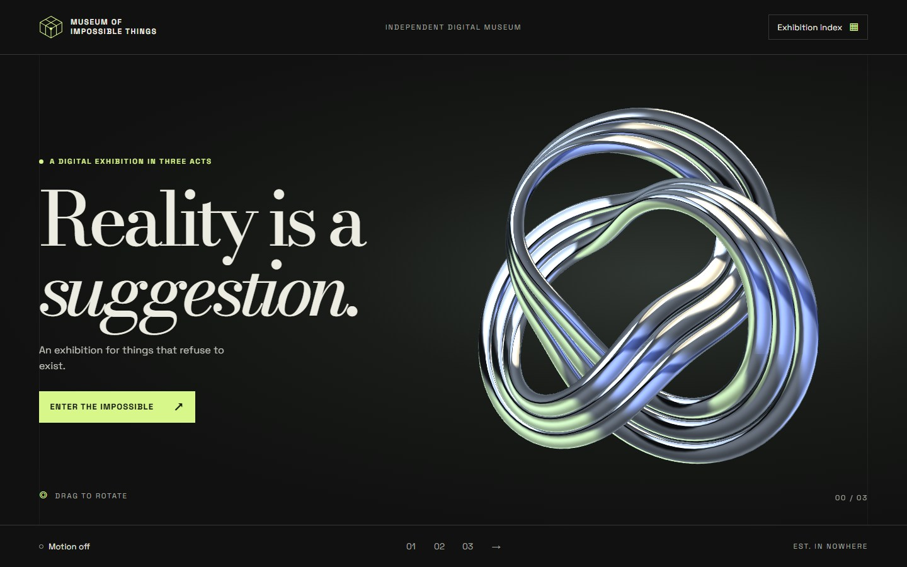

# The Museum of Impossible Things

**An exhibition for things that refuse to exist.**



A browser-native digital museum in three acts. Visitors cross a graphite threshold, change the state of a suspended sculpture, give language a temporary physical form, and fold an architectural passage around its vanishing point.

| Exhibition | Interaction |
| --- | --- |
| The Weight of Light | Drag or use arrow keys to turn the sculpture. Switch between Solid, Fluid, and Spectral, or reset its orientation. |
| Words That Refuse to Stay Still | Submit a phrase, then move the pointer, tap, or press Enter on the artwork. Choose Elastic, Fragment, or Liquid. |
| The Room That Breathes | Look around with a pointer or the arrow keys, move the passage depth slider, and fold the corridor. |

The exhibition index offers direct access to the three works. Hash links support browser history and room bookmarks. The closing sequence links back to the entrance.

## Development

Requires Node.js 24 and npm.

```sh
npm ci
npm run dev
```

Use `npm run build` and `npm run preview` to inspect the production bundle. The site is static and uses relative asset paths for GitHub Pages.

```sh
npm run typecheck
npm run lint
npm test
npm run build
npx playwright install chromium
npm run test:e2e
```

The Playwright suite runs against the production preview by default. Set `MUSEUM_TEST_URL` to test an existing deployment. The `?flat` query parameter forces the non-WebGL experience.

## Engineering

- **React, TypeScript, and Vite** provide the interface, typed room catalog, and static production build. The exhibit index uses a native modal dialog for keyboard focus and Escape support.
- **Three.js, React Three Fiber, and Drei** render a lazily loaded WebGL gallery. The sculpture uses three custom indexed ribbon meshes and GLSL that drives coherent vertex displacement, analytic reflections, Fresnel edges, and alpha transitions. The passages use stacked polygonal portals with interior surfaces, staggered breathing, and constrained camera controls.
- **GSAP and @gsap/react** choreograph scene transitions and label reveals. The typography exhibit uses SVG transforms, horizontal clipping masks, and turbulence displacement with accessible HTML controls.
- **Rendering costs** are limited to one active scene, with DPR caps, lower ribbon resolution on smaller canvases, and a suspended frame loop in hidden tabs. Cached images from the actual exhibits provide gallery previews and WebGL fallbacks. The lazy Three.js chunk is the largest part of the build.

`src/App.tsx` owns navigation and input. `src/experience/catalog.ts` contains shared exhibit definitions. `GalleryCanvas.tsx` contains the sculpture, passage geometry, shaders, and cameras. `WordArt.tsx` contains the typography artwork. `tests/` covers routing, interactions, input, responsive navigation, and fallback asset loading.

## Accessibility and limits

Motion defaults to the system preference and can be changed from the footer. Headings receive focus on navigation. The spatial artwork and typography have keyboard controls and accessible descriptions. Static previews replace continuous 3D when WebGL 2 is unavailable. The fallback approximates material and room changes with image transforms.

The exhibition is silent. Automated browser testing targets Chromium, including portrait and landscape layouts. Headless software rendering verifies functionality, while GPU performance on physical mobile devices remains unmeasured.

## Credits

The museum identity, artwork, geometry, shaders, and previews were created for this project. Bodoni Moda and Space Grotesk are distributed under the SIL Open Font License. Full notices are retained in [the font credits](docs/font-licenses). [Bodoni Moda](https://github.com/indestructible-type/Bodoni) · [Space Grotesk](https://github.com/floriankarsten/space-grotesk)

[Portfolio notes and screenshots](docs/portfolio/README.md)
